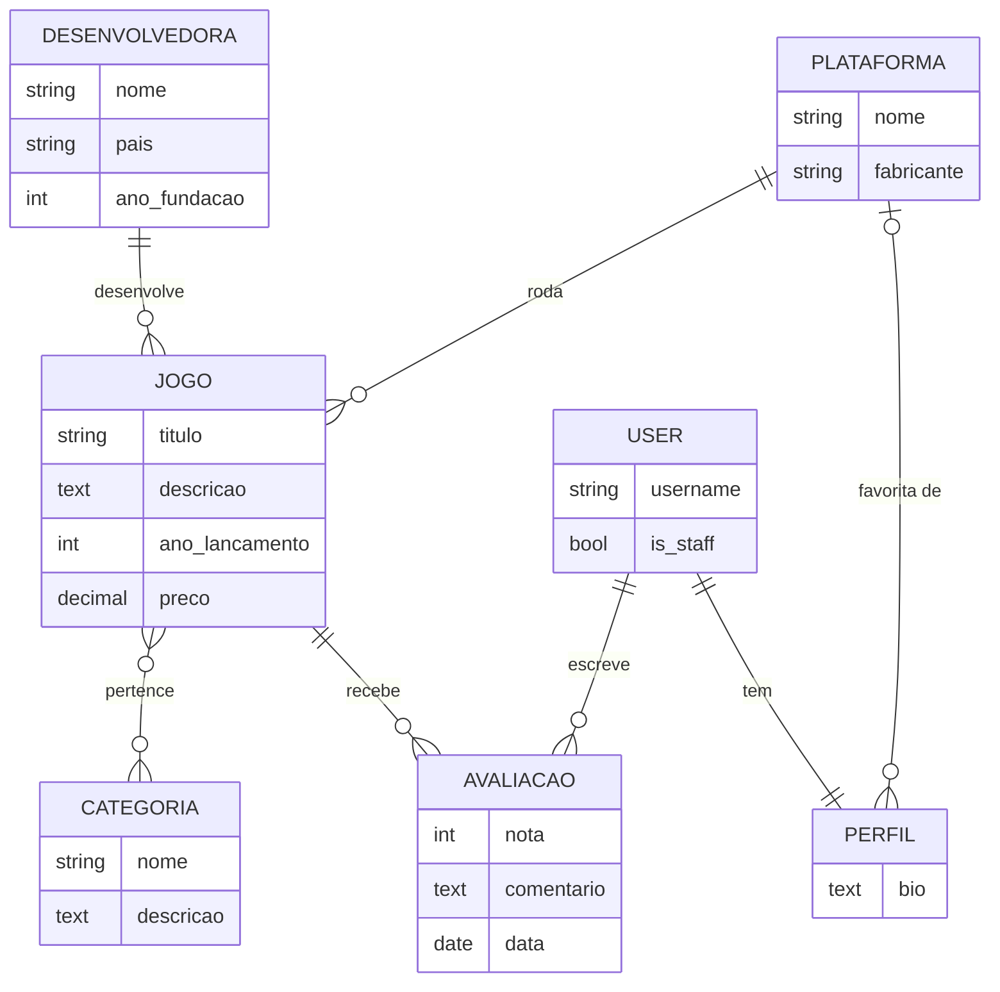

# 🎮 GameDex

Catálogo de jogos feito em **Django**: projeto acadêmico do curso de Análise e Desenvolvimento de Sistemas.

Dá para pesquisar jogos com filtros, criar uma conta, avaliar com nota de 1 a 5 e manter um perfil. O site tem dois níveis de acesso: o **admin** cadastra, edita e exclui jogos, e o **usuário comum** avalia e edita o próprio perfil. Desenvolvedoras, categorias e plataformas são gerenciadas pelo painel administrativo do Django.


---

## 📑 Sumário

- [Funcionalidades](#-funcionalidades)
- [Níveis de acesso](#-níveis-de-acesso)
- [Tecnologias](#-tecnologias)
- [Modelo de dados](#-modelo-de-dados)
- [Estrutura do projeto](#-estrutura-do-projeto)
- [Rotas](#-rotas)
- [Pré-requisitos](#-pré-requisitos)
- [Instalação](#-instalação)
- [Conferir se ficou tudo certo](#-conferir-se-ficou-tudo-certo)
- [Testes automáticos](#-testes-automáticos)
- [Deu erro?](#️-deu-erro)
- [Endereços e logins](#-endereços-e-logins)
- [Usar o SQLite](#️-usar-o-sqlite-em-vez-do-mysql-sem-instalar-mysql)

---

## ✨ Funcionalidades

- **Página inicial** com os últimos jogos cadastrados
- **Lista de jogos com filtros de pesquisa**: busca por título ou desenvolvedora, categoria, plataforma, faixa de preço, ano, nota média, ordenação e paginação
- **Detalhes do jogo**: desenvolvedora, plataforma, categorias, preço e avaliações
- **CRUD de jogos** (só admin): cadastrar, editar e excluir, com página de confirmação
- **Contas de usuário**: criar conta, entrar e sair
- **Avaliações** (precisa estar logado) com nota de 1 (Péssimo) a 5 (Excelente) e comentário
- **Meu perfil**: bio, plataforma favorita e a lista das avaliações feitas
- **Views baseadas em classe** (`ListView`, `DetailView`, `CreateView`, `UpdateView`, `DeleteView`, `TemplateView`)
- **Painel admin** do Django para Desenvolvedoras, Categorias, Plataformas, Jogos, Avaliações e Perfis
- Tema escuro com CSS próprio, sem frameworks
- Código **comentado em português** para estudo, com o guia [`GUIA_ESTUDO.md`](GUIA_ESTUDO.md)

## 🔐 Níveis de acesso

| Nível | Quem é | O que pode fazer |
|---|---|---|
| Visitante | não está logado | ver o início, a lista (com filtros) e os detalhes dos jogos |
| **User** | conta criada em `/cadastro/` | tudo do visitante + avaliar jogos + editar o próprio perfil |
| **Admin** | usuário com `is_staff` (ex.: `admin`) | tudo do user + cadastrar, editar e excluir jogos + painel `/admin/` |

O bloqueio é feito nas views (`LoginRequiredMixin` e um `AdminRequiredMixin` próprio), não só escondendo botões: um user que abrir `/jogos/1/editar/` direto recebe a página **403 – Acesso negado**. Para transformar um user em admin, marque **Membro da equipe** no cadastro dele em `/admin/`.

## 🧰 Tecnologias

| Camada | Tecnologia |
|---|---|
| Linguagem | Python 3.12+ |
| Framework | Django 6.1 |
| Banco de dados | MySQL 8.4+ / MariaDB 10.11+ (via PyMySQL); SQLite opcional |
| Front-end | Django Templates + CSS |

## 🗂️ Modelo de dados



| Relacionamento | Tipo | Como foi feito |
|---|---|---|
| Desenvolvedora → Jogo | 1:N | `ForeignKey` com `PROTECT` (não deixa apagar uma desenvolvedora que tem jogos) |
| Plataforma → Jogo | 1:N | `ForeignKey` com `PROTECT` |
| Jogo → Avaliação | 1:N | `ForeignKey` com `CASCADE` (apagar o jogo apaga as avaliações dele) |
| Usuário → Avaliação | 1:N | `ForeignKey` com `CASCADE` (cada avaliação é de quem estava logado) |
| Plataforma → Perfil | 1:N | `ForeignKey` com `SET_NULL` (plataforma favorita, opcional) |
| **Usuário ↔ Perfil** | **1:1** | `OneToOneField` com `CASCADE` (cada usuário tem um perfil só) |
| Jogo ↔ Categoria | N:N | `ManyToManyField` (o Django cria a tabela intermediária) |

`User` é o model de usuário que já vem no Django (`django.contrib.auth`).

## 📁 Estrutura do projeto

```
├── banco/
│   └── gamedex.sql          # script que cria o banco, o usuário, as tabelas e os dados de exemplo
├── catalogo/                # app principal
│   ├── migrations/          # histórico de alterações do banco
│   ├── static/catalogo/css/ # style.css
│   ├── templates/
│   │   ├── 403.html         # página de acesso negado
│   │   └── catalogo/        # páginas HTML (base, lista, detalhe, formulários, login, perfil...)
│   ├── admin.py             # registro dos models no painel admin
│   ├── forms.py             # JogoForm, AvaliacaoForm, PerfilForm e FiltroJogoForm
│   ├── models.py            # Jogo, Categoria, Desenvolvedora, Plataforma, Avaliacao, Perfil
│   ├── tests.py             # testes automáticos (níveis de acesso e filtros)
│   ├── urls.py              # rotas do app
│   └── views.py             # views baseadas em classe
├── gamedex/                 # configurações do projeto (settings.py, urls.py...)
├── GUIA_ESTUDO.md           # guia de estudo do código
├── manage.py
└── requirements.txt
```

## 🧭 Rotas

| URL | Página | Acesso |
|---|---|---|
| `/` | Início | todos |
| `/jogos/` | Lista de jogos com filtros (ex.: `/jogos/?busca=zelda&preco_max=300`) | todos |
| `/jogos/<id>/` | Detalhes do jogo | todos |
| `/jogos/novo/` | Cadastrar jogo | admin |
| `/jogos/<id>/editar/` | Editar jogo | admin |
| `/jogos/<id>/excluir/` | Excluir jogo | admin |
| `/jogos/<id>/avaliar/` | Avaliar jogo | logado |
| `/cadastro/` | Criar conta | todos |
| `/login/` e `/logout/` | Entrar e sair | todos |
| `/perfil/` | Meu perfil | logado |
| `/admin/` | Painel administrativo | admin |

---

## 📦 Pré-requisitos

#### Python (3.12 ou mais novo)
- **Windows:** baixe em https://www.python.org/downloads/ e, na primeira tela do instalador, **marque "Add python.exe to PATH"**.
- **Linux (Ubuntu/Debian):** `sudo apt install python3 python3-venv`

Para conferir, abra um terminal e digite:
```
python --version      (Windows)
python3 --version     (Linux)
```
Tem que aparecer `Python 3.12` ou maior.

#### MySQL (8.4 ou mais novo) ou MariaDB (10.11 ou mais novo)
- **Windows:** baixe o **MySQL Server 8.4** em https://dev.mysql.com/downloads/mysql/ (opção "Windows (x86, 64-bit), MSI Installer"). Durante a instalação ele pede uma **senha para o usuário root**: **anote essa senha**, ela é usada na criação do banco.
  Baixe também o **MySQL Workbench** em https://dev.mysql.com/downloads/workbench/ (é o programa com tela para rodar o script).
- **Linux (Ubuntu/Debian):** use o MariaDB, que já vem nos repositórios em uma versão compatível:
  ```
  sudo apt install mariadb-server
  sudo systemctl start mariadb
  ```

Para conferir:
- **Windows:** abra o MySQL Workbench e clique na conexão "Local instance". Se pedir a senha do root e conectar, está funcionando.
- **Linux:** `sudo mariadb -e "select version();"`: tem que mostrar `10.11` ou maior.

> ⚠️ Versões antigas não funcionam com o Django 6.1: o XAMPP costuma vir com MariaDB 10.4, e o pacote `mysql-server` do Ubuntu 24.04 é o MySQL 8.0. Veja a seção "Deu erro?".

Você também precisa do **Git** (https://git-scm.com/) para clonar o repositório.

---

## 🚀 Instalação

### Resumo rápido

```bash
git clone https://github.com/nicolasdosantos/GamesDjango.git
cd GamesDjango
python -m venv venv                 # Linux: python3 -m venv venv
venv\Scripts\activate               # Linux: source venv/bin/activate
pip install -r requirements.txt
# rodar banco/gamedex.sql no MySQL como root (Workbench ou terminal)
python manage.py runserver
```

Depois é só abrir http://127.0.0.1:8000/ (admin: `admin` / `admin123`, user: `usuario` / `usuario123`).

Se é a primeira vez, siga o passo a passo abaixo.

### 1. Clonar o repositório
```bash
git clone https://github.com/nicolasdosantos/GamesDjango.git
cd GamesDjango
```
Sem Git, dá para baixar pelo botão **Code > Download ZIP** aqui no GitHub e descompactar. Depois abra um terminal **dentro da pasta do projeto**, que é a pasta onde está o `manage.py`:
- **Windows:** abra a pasta no Explorador de Arquivos, clique na **barra de endereço**, digite `cmd` e aperte **Enter**.
- **Linux:** clique com o botão direito dentro da pasta e escolha **Abrir no terminal**.

### 2. Criar o ambiente virtual (venv)
O ambiente virtual é uma pasta com um Python só deste projeto.

| Windows | Linux |
|---|---|
| `python -m venv venv` | `python3 -m venv venv` |

### 3. Ativar o ambiente virtual
| Windows (Prompt de Comando) | Windows (PowerShell) | Linux |
|---|---|---|
| `venv\Scripts\activate` | `venv\Scripts\Activate.ps1` | `source venv/bin/activate` |

Vai aparecer `(venv)` no começo da linha do terminal.
**Esse passo precisa ser repetido toda vez que abrir um terminal novo** (o passo 2 não, ele é só uma vez).

### 4. Instalar as bibliotecas
```bash
pip install -r requirements.txt
```

### 5. Criar o banco de dados (só na primeira vez)
O arquivo `banco/gamedex.sql` cria o banco, o usuário do projeto, as tabelas, os jogos de exemplo e o login do admin. Ele precisa ser rodado **uma vez**, com o usuário **root** do MySQL.

**Opção A: pelo MySQL Workbench (Windows)**
1. Abra o Workbench e entre na conexão "Local instance" com a senha do root.
2. Menu **File > Open SQL Script** e escolha o arquivo `banco/gamedex.sql` do projeto.
3. Clique no ícone do **raio** (Execute).
4. No final aparece `Banco gamedex criado com sucesso!`.

**Opção B: pelo terminal**

| Windows (Prompt de Comando) | Linux |
|---|---|
| `"C:\Program Files\MySQL\MySQL Server 8.4\bin\mysql.exe" -u root -p`<br>digite a senha do root e depois:<br>`source C:/caminho/da/pasta/do/projeto/banco/gamedex.sql`<br>(no `source`, use barras `/`)<br>para sair: `exit` | `sudo mariadb < banco/gamedex.sql` |

Não precisa mexer no `settings.py`: o projeto já está configurado para o usuário que o script cria (`gamedex` / `Gamedex@2026`).

> ⚠️ Rodar o script de novo **apaga e recria** o banco `gamedex`, voltando para os dados de exemplo.

### 6. Ligar o servidor
```bash
python manage.py runserver
```
Deixe esse terminal aberto enquanto usa o site. Para desligar, aperte `Ctrl + C`.

### 7. Abrir no navegador
| O quê | Endereço |
|---|---|
| Site | http://127.0.0.1:8000/ |
| Painel admin | http://127.0.0.1:8000/admin/ |

| Nível | Usuário | Senha |
|---|---|---|
| Admin | `admin` | `admin123` |
| User | `usuario` | `usuario123` |

---

## ✅ Conferir se ficou tudo certo

- [ ] A página inicial abre e mostra "Últimos jogos cadastrados" com 3 jogos.
- [ ] Em **Jogos** aparecem 8 jogos (Minecraft, Zelda, Elden Ring...).
- [ ] Em **Elden Ring** aparecem as categorias **Ação**, **RPG** e **Mundo aberto**, com os acentos certos, e 2 avaliações.
- [ ] Em **Jogos**, filtrar por **Preço até 200** mostra 3 jogos.
- [ ] Sem login, o botão do jogo é **Entre para avaliar** e não aparecem Editar/Excluir.
- [ ] Entrando com `usuario` / `usuario123`: dá para avaliar e editar o **Meu perfil**, e abrir `/jogos/1/editar/` mostra **Acesso negado**.
- [ ] Entrando com `admin` / `admin123`: dá para cadastrar, editar e excluir jogos, e o `/admin/` mostra Jogos, Categorias, Plataformas, Desenvolvedoras, Avaliações e Perfis.

**Nas próximas vezes**, só precisa ativar a venv (passo 3) e rodar `python manage.py runserver` (passo 6), com o MySQL ligado.

---

## 🧪 Testes automáticos

Com a venv ativada e o MySQL ligado:

```bash
python manage.py test catalogo
```

São 22 testes (`catalogo/tests.py`) que conferem os níveis de acesso, o cadastro com perfil e os filtros. O Django cria um banco separado (`test_gamedex`) só para os testes e apaga no final, então os dados do site não são alterados.

---

## 🛠️ Deu erro?

**PowerShell: "a execução de scripts foi desabilitada neste sistema"** (ao ativar a venv)
Rode uma vez `Set-ExecutionPolicy -Scope CurrentUser RemoteSigned`, responda `S` e tente ativar de novo. Ou use o **Prompt de Comando** (cmd) em vez do PowerShell, com `venv\Scripts\activate`.

**"python não é reconhecido como um comando"**
O Python foi instalado sem marcar "Add python.exe to PATH". Tente usar `py` no lugar de `python`, ou reinstale o Python marcando essa opção.

**"Did you install mysqlclient?" ou "No module named pymysql" ou "No module named django"**
As bibliotecas não foram instaladas, ou a venv não está ativada. Ative a venv (passo 3) e rode `pip install -r requirements.txt` de novo.

**"Can't connect to MySQL server on 'localhost'" (erro 2003)**
O MySQL não está ligado.
- Windows: abra **Serviços**, procure **MySQL84** e clique em **Iniciar**.
- Linux: `sudo systemctl start mariadb`

**"Access denied for user 'gamedex'" (erro 1045) ou "Unknown database 'gamedex'" (erro 1049)**
O script `banco/gamedex.sql` não foi rodado neste computador, ou parou no meio. Rode de novo como root (passo 5).

**"Access denied for user 'root'" ao rodar o script**
- Windows: é a senha que você criou na instalação do MySQL.
- Linux: no MariaDB o root entra pelo `sudo`, sem senha: `sudo mariadb < banco/gamedex.sql`.

**Quero usar outro usuário do MySQL (ou mudei a senha do gamedex)**
Abra `gamedex/settings.py`, procure o bloco `DATABASES` do MySQL e troque o `USER` e o `PASSWORD`:
```python
'USER': 'seu_usuario',
'PASSWORD': 'sua_senha',
```
Esse usuário precisa ter permissão no banco `gamedex`. Com o root funciona, mas não é recomendado.

**"MySQL 8.4 or later is required" ou "MariaDB 10.11 or later is required"**
O MySQL/MariaDB instalado é antigo demais para o Django 6.1. Isso acontece com o XAMPP (MariaDB 10.4) e com o `mysql-server` do Ubuntu 24.04 (MySQL 8.0). Instale o MySQL 8.4 (Windows) ou o `mariadb-server` (Linux), como na seção "Pré-requisitos". Ou use o SQLite (seção "Usar o SQLite").

**"That port is already in use" (porta 8000 ocupada)**
Rode em outra porta: `python manage.py runserver 8001` e abra http://127.0.0.1:8001/

**A porta 3306 está ocupada / tenho outro MySQL ou o XAMPP ligado**
Desligue o outro (no XAMPP, botão **Stop** do MySQL). Se o seu MySQL usa outra porta, troque o `'PORT': '3306'` no `settings.py`.

**Acentos estranhos (ex: "Ação" no lugar de "Ação")**
Rode o script de novo pelo Workbench ou pelo comando do passo 5. Pelo terminal, também dá para forçar o UTF-8: `mysql -u root -p --default-character-set=utf8mb4`.
Se o erro aparece só **no terminal do MySQL** e o site está certo, não tem problema: é só o terminal do Windows mostrando os caracteres de outro jeito.

**O site abre, mas sem cores/estilo**
Confira se a pasta `catalogo/static/` existe e se o servidor foi ligado com `python manage.py runserver`.

---

## 🔑 Endereços e logins

| O quê | Valor |
|---|---|
| Site | http://127.0.0.1:8000/ |
| Admin | http://127.0.0.1:8000/admin/ (usuário `admin`, senha `admin123`) |
| Usuário comum | `usuario`, senha `usuario123` |
| Banco no MySQL | `gamedex` |
| Usuário do MySQL usado pelo projeto | `gamedex`, senha `Gamedex@2026` (criado pelo script) |

---

## 🗃️ Usar o SQLite em vez do MySQL (sem instalar MySQL)

Se não quiser (ou não conseguir) instalar o MySQL, o projeto também roda com o SQLite, que já vem com o Python. Ele usa o arquivo `db.sqlite3`, que tem os dados antigos do projeto.
1. Faça os passos 1 a 4 da instalação normalmente (pule o 5).
2. Abra `gamedex/settings.py` e procure `DATABASES`.
3. Tire o `#` do começo das 6 linhas do bloco **SQLite**.
4. Coloque `#` no começo de todas as linhas do bloco **MySQL** (de `DATABASES = {` até o `}` final dele).
5. Rode `python manage.py runserver` normalmente.

O usuário admin do SQLite é outro, com a senha que já existia nele. Se não lembrar a senha, rode `python manage.py changepassword admin`. O usuário comum `usuario` só existe no MySQL: no SQLite, crie uma conta em `/cadastro/`.

---

## ⚠️ Aviso

Este é um projeto de estudo, configurado para rodar **só localmente** (`DEBUG = True`, `SECRET_KEY` e senhas de exemplo no código). Não use estas configurações em produção.

## 👤 Autor

**Nicolas Pichiteli dos Santos**: [@nicolasdosantos](https://github.com/nicolasdosantos)
